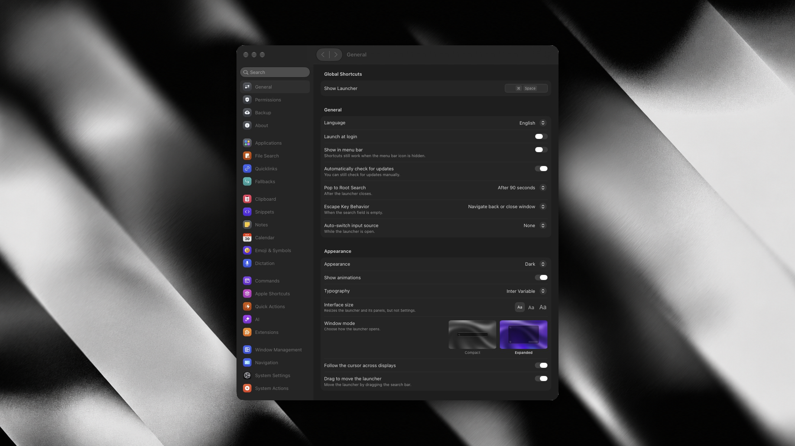

# Tinycast · personal fork

A native macOS launcher built with SwiftUI and AppKit. Launch apps, search files, reuse your
clipboard, run commands, and work with notes, snippets, and Raycast extensions from one palette.

Maintained by [mallenkb](https://github.com/mallenkb). This is an independent fork of
[Tinycast](https://github.com/abue-ammar/tinycast), created by
[Abue Ammar](https://github.com/abue-ammar). The original author’s copyright, contributor history,
and AGPL-3.0-or-later license are preserved.

[Contact @mallenkb on X](https://x.com/mallenkb) ·
[Report a bug](https://github.com/mallenkb/tinycast/issues) ·
[Build from source](#build-from-source) · [Documentation](docs/README.md)

## App preview

<p align="center">
  
</p>

## Settings in dark mode

The full Settings window, captured from Tinycast Dev, with grouped navigation, the updated icons,
and typography controls. This screenshot shows the local development build; some changes are still
pending publication, as noted below.

<p align="center">
  
</p>

## Fork highlights

- **Rich clipboard link previews.** See a copied page’s title, site icon, and preview image without
  opening the browser, with a loading indicator while metadata is fetched.
- **Rendered SVG previews.** View copied SVG markup as an image in the clipboard preview, with an
  SVG-specific row icon and type label. This is in the latest local build, pending publication.
- **Live file search.** See matching files in the main launcher as you type when File Search and
  Show in launcher are enabled. No need to open the Search Files command first.
- **Typography choices.** Choose the default system font or Inter Variable in Settings.
- **Palette refinements.** Smoother cursor blinking, appearance-aware caret colors, and refinements
  to the search field and panel styling.
- **Redesigned feature icons.** Consistent sizing, light and dark variants, and grouped settings
  navigation. The latest icon set is in the local build, pending publication.
- **Memory improvements.** Smaller preview and icon caches, cancellation of obsolete file searches,
  and resource cleanup when Settings closes. These changes are in the local build, pending publication.

The published source already includes link previews, live file search, and typography settings.
The newer SVG, icon, and memory changes have not yet been pushed. See
[fork status](docs/fork.md) for the distinction. Memory use varies with the workload; this fork does
not promise to stay below 100 MB during every operation.

## Features

| Area | What you can do |
| --- | --- |
| Launcher | Fuzzy app search, favorites, running-app indicators, global and per-app hotkeys |
| Files | Search a local filename index across configured folders, with results in the launcher |
| Clipboard | Search text and images, preview links, and paste into the previous app |
| Calculator | Calculate expressions and convert units, currencies, and cryptocurrencies |
| Writing | Use the Mac’s dictionaries, searchable emoji, snippets, and Markdown notes |
| Automation | Run custom shell commands, Apple Shortcuts, quicklinks, and Raycast extensions |
| Mac controls | Manage windows, navigate windows, and run system actions |
| Calendar | View upcoming meetings and join them from the palette |
| AI and dictation | Use configurable AI providers, text Quick Actions, and dictation |
| Backup | Export settings or import a setup from Raycast |

File Search uses Tinycast’s own filename index, not Spotlight. It requires Full Disk Access and
indexes the folders configured in Settings. AI features are off by default.

## Build from source

There is no published binary release of this fork yet. Build the source in this repository to use
its published changes. The original project’s Homebrew casks and downloads install the upstream app.

Requirements: macOS 26 or later, Xcode 27 as specified in the development guide, and the local
signing identity described in [signing.md](docs/signing.md).

```sh
git clone https://github.com/mallenkb/tinycast.git
cd tinycast
./Scripts/build-and-run.sh
```

This builds **Tinycast Dev**, with its own preferences, data, and permissions, separate from an
installed Tinycast app. Grant the Dev app its own permissions and configure its shortcuts.

To package a local Release build:

```sh
./Scripts/build-dmg.sh
```

The DMG is written under `build/`. Release builds use the same `com.tinycast.app` identity as the
original stable app, so installing one replaces that app and uses its data. Use Tinycast Dev while
trying the fork alongside the original.

The current in-app updater still checks upstream releases. It is not a distribution channel for
this fork. See [fork status](docs/fork.md) before publishing or installing a Release build.

## Feedback and contributions

For this fork, use [GitHub Issues](https://github.com/mallenkb/tinycast/issues) or contact
[@mallenkb on X](https://x.com/mallenkb). Include your macOS version, build or commit, and steps to
reproduce a problem. See [CONTRIBUTING.md](CONTRIBUTING.md) for contribution guidelines and
[SECURITY.md](SECURITY.md) for private vulnerability reports.

For the original project, visit [abue-ammar/tinycast](https://github.com/abue-ammar/tinycast).
You can support its original author through the [upstream support page](https://tinycast.dev/support).

## Credits and license

Tinycast was created by [Abue Ammar](https://github.com/abue-ammar) with contributions from the
[upstream community](https://github.com/abue-ammar/tinycast/graphs/contributors).
This fork is maintained separately by [mallenkb](https://github.com/mallenkb).

The code is licensed under [AGPL-3.0-or-later](LICENSE). Inter Variable includes its own
[font license](Tinycast/Resources/Fonts/LICENSE.txt). Original notices and contributor history remain
in the repository.
